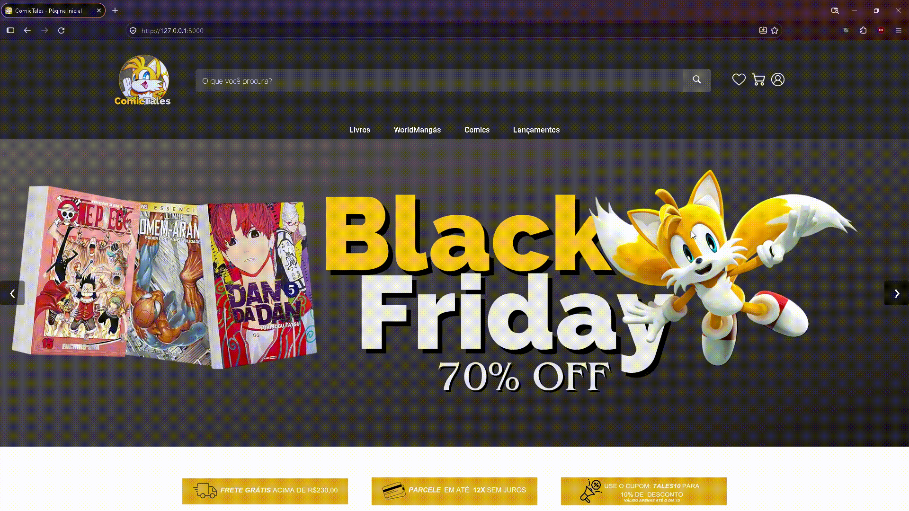

<h1 align="center" style="font-weight: bold;">ComicTales</h1>

<p align="center">
    
</p>

[PYTHON__BADGE]: https://img.shields.io/badge/Python-%233776AB.svg?style=for-the-badge&logo=python&logoColor=white
[FLASK__BADGE]: https://img.shields.io/badge/Flask-%23000000.svg?style=for-the-badge&logo=flask&logoColor=white
[MYSQL__BADGE]: https://img.shields.io/badge/MySQL-%2300f.svg?style=for-the-badge&logo=mysql&logoColor=white
[BOOTSTRAP__BADGE]: https://img.shields.io/badge/Bootstrap-%23563D7C.svg?style=for-the-badge&logo=bootstrap&logoColor=white

<p align="center">
  <a href="#technologies">Tecnologias</a> •
  <a href="#started">Iniciando</a> •
  <a href="#layout">Layout/Preview</a> •
  <a href="#routes">Rotas Principais</a> •
  <a href="#colab">Colaboradores</a> •
  <a href="#contribute">Contribua</a>
</p>

<p align="center">
    <b>Plataforma de e-commerce e vitrine digital especializada em quadrinhos, mangás e colecionáveis.</b>
</p>

<h2 id="layout">🎨 Layout/Preview</h2>

<p align="center">
    
    <br />
    
    <br />
    
</p>

<h2 id="technologies">💻 Tecnologias</h2>

<div>

![Python][PYTHON__BADGE]
![Flask][FLASK__BADGE]
![MySQL][MYSQL__BADGE]
![Bootstrap][BOOTSTRAP__BADGE]

</div>

<h2 id="started">🚀 Iniciando</h2>

Siga as instruções abaixo para configurar e rodar o projeto localmente na sua máquina.

<h3>Pré-requisitos</h3>

Lista dos pré-requisitos necessários:

- [Python 3.10+](https://www.python.org/)
- [MySQL Server / XAMPP](https://www.mysql.com/)
- [Git](https://git-scm.com/)

<h3>Clonando</h3>

```bash
git clone https://github.com/JoaoxVictorMS/ComicTales.git
cd ComicTales
```

<h3>Configurando o Ambiente Virtual e Dependências</h3>

Crie e ative o seu ambiente virtual Python, e em seguida instale os pacotes necessários:

```bash
# Criar o ambiente virtual
python -m venv .venv

# Ativar no Windows (PowerShell)
.venv\Scripts\Activate

# Ativar no Linux/macOS
source .venv/bin/activate

# Instalar as dependências
pip install -r requirements.txt
```

<h3>Configurando o Banco de Dados e Inicialização</h3>

Certifique-se de que o seu servidor MySQL local está ativo. Verifique as credenciais de conexão (usuário e senha) nos arquivos `config.py` e `prepara_banco.py`, e execute o script de preparação para criar o banco de dados `comictales`, todas as tabelas relacionais e o administrador padrão:

```bash
python prepara_banco.py
```

- **Credenciais de Administrador (geradas automaticamente):**
  - **E-mail:** `admin@comictales.com`
  - **Senha:** `12341234`

> **Nota sobre o catálogo inicial:** O banco de dados é criado com as tabelas vazias. Para testar a loja (como adicionar itens à lista de desejos ou ao carrinho sem erros de chave estrangeira), acesse o painel administrativo (`/admin/login`) e cadastre pelo menos um produto no catálogo.

<h3>Criando um Cliente de Teste (Opcional)</h3>

Caso queira testar o fluxo de compras, carrinho e lista de desejos sem precisar preencher o formulário de cadastro na interface, execute o script utilitário (que já gera a senha criptografada no padrão exigido pelo `Flask-Bcrypt`):

```bash
python criar_usuario_teste.py
```

- **Credenciais de Cliente de Teste:**
  - **E-mail:** `cliente@comictales.com`
  - **Senha:** `12341234`

<h3>Executando</h3>

Com o banco de dados preparado, inicie o servidor Flask localmente:

```bash
python comictales.py
```

Acesse a aplicação no seu navegador através de: `http://127.0.0.1:5000`

<h2 id="routes">📍 Rotas e Endpoints da Aplicação</h2>

Abaixo estão listadas todas as rotas mapeadas na aplicação **ComicTales**, divididas por módulos funcionais:

### 🌐 Páginas Públicas, Catálogo e Busca
| Rota | Método | Descrição |
| :--- | :---: | :--- |
| `<kbd>GET /</kbd>` | `GET` | Página inicial / Vitrine principal do e-commerce. |
| `<kbd>GET /produto/<int:produto_id></kbd>` | `GET` | Página de exibição e detalhes de um quadrinho ou item específico. |
| `<kbd>GET /search</kbd>` | `GET` | Processa a barra de busca e redireciona para os resultados. |
| `<kbd>GET /search_results</kbd>` | `GET` | Exibe a página estruturada com os resultados da pesquisa. |
| `<kbd>GET /dc</kbd>` | `GET` | Vitrine filtrada com produtos do universo DC Comics. |
| `<kbd>GET /marvel</kbd>` | `GET` | Vitrine filtrada com produtos do universo Marvel. |
| `<kbd>GET /livros</kbd>` | `GET` | Vitrine filtrada de livros e publicações especiais. |
| `<kbd>GET /world_mangas</kbd>` | `GET` | Vitrine dedicada ao mundo dos mangás. |
| `<kbd>GET /personagem/<personagem_url></kbd>` | `GET` | Filtro dinâmico de produtos por personagem específico. |
| `<kbd>GET /template_lancamentos</kbd>` | `GET` | Seção especial de novos lançamentos da loja. |
| `<kbd>GET /perguntas_frequentes</kbd>` | `GET` | Página institucional de FAQ (Dúvidas frequentes). |
| `<kbd>GET /politica_cookie</kbd>` | `GET` | Termos e política de cookies. |
| `<kbd>GET /politica_privacidade</kbd>` | `GET` | Política de privacidade do e-commerce. |
| `<kbd>GET /termos_condicoes</kbd>` | `GET` | Termos e condições gerais de uso. |

### 👤 Autenticação e Gestão de Clientes
| Rota | Método | Descrição |
| :--- | :---: | :--- |
| `<kbd>GET /login</kbd>` | `GET` | Exibe a tela de login de clientes. |
| `<kbd>POST /autenticar</kbd>` | `POST` | Processa as credenciais de login do usuário (com verificação de senha via Bcrypt). |
| `<kbd>GET /criar_conta.html</kbd>` | `GET` / `POST` | Exibe o formulário e processa o cadastro de uma nova conta de cliente. |
| `<kbd>GET /logout</kbd>` | `GET` | Encerra a sessão ativa do usuário cliente. |
| `<kbd>GET /minha_conta</kbd>` | `GET` | Painel do cliente logado (exibe dados cadastrais). |
| `<kbd>GET /meus_enderecos</kbd>` | `GET` / `POST` | Gerenciamento e listagem dos endereços cadastrados do usuário. |
| `<kbd>GET /adicionar_endereco</kbd>` | `GET` / `POST` | Formulário para cadastro de um novo endereço de entrega. |
| `<kbd>GET /editar_endereco/<int:id></kbd>` | `GET` / `POST` | Edição de um endereço já cadastrado. |
| `<kbd>POST /remover_endereco/<int:id></kbd>` | `POST` | Exclusão de um endereço do usuário. |
| `<kbd>GET /meus_pedidos</kbd>` | `GET` | Histórico de compras e pedidos realizados pelo cliente. |

### 🛒 Carrinho, Lista de Desejos e Checkout
| Rota | Método | Descrição |
| :--- | :---: | :--- |
| `<kbd>GET /carrinho</kbd>` | `GET` | Exibe os itens adicionados no carrinho de compras e o valor total. |
| `<kbd>POST /adicionar_ao_carrinho/<id></kbd>` | `POST` | Adiciona uma quantidade específica de um produto ao carrinho. |
| `<kbd>POST /remover_do_carrinho/<id></kbd>` | `POST` | Remove um item do carrinho de compras. |
| `<kbd>GET /lista_de_desejos</kbd>` | `GET` | Exibe a lista de produtos salvos como favoritos pelo cliente. |
| `<kbd>POST /adicionar_a_lista_de_desejos/<id></kbd>`| `POST` | Adiciona um item à lista de desejos (requer autenticação). |
| `<kbd>POST /remover_da_lista_de_desejos/<id></kbd>` | `POST` | Remove um item da lista de desejos. |
| `<kbd>GET /checkout</kbd>` | `GET` / `POST` | Página de revisão de endereço e pagamento para fechamento do pedido. |
| `<kbd>POST /processar_checkout</kbd>` | `POST` | Converte o carrinho em pedidos definitivos e limpa o carrinho. |

### ⚙️ Painel Administrativo (Restrito)
> *Nota: Todas as rotas abaixo são protegidas pelo decorador personalizado `@admin_required`, exigindo sessão de administrador ativa.*

| Rota | Método | Descrição |
| :--- | :---: | :--- |
| `<kbd>GET /admin/login</kbd>` | `GET` / `POST` | Tela de autenticação exclusiva para administradores. |
| `<kbd>GET /admin/logout</kbd>` | `GET` | Encerra a sessão administrativa. |
| `<kbd>GET /produtos</kbd>` | `GET` | Painel principal de listagem e gerenciamento de produtos. |
| `<kbd>POST /produtos/adicionar</kbd>` | `POST` | Processa o cadastro de novo produto e upload de imagem. |
| `<kbd>GET /produtos/editar/<id></kbd>` | `GET` / `POST` | Formulário e processamento da edição de um produto. |
| `<kbd>POST /produtos/excluir/<id></kbd>` | `POST` | Remove permanentemente um produto da base de dados. |

<h2 id="contribute">📫 Contribua</h2>

Contribuições são sempre bem-vindas! Siga os passos abaixo para colaborar com o projeto:

1. Faça um fork ou clone o repositório: `git clone https://github.com/JoaoxVictorMS/ComicTales.git`
2. Crie uma branch para a sua funcionalidade: `git checkout -b feature/NOME_DA_FEATURE`
3. Faça o commit das suas alterações seguindo os padrões convencionais
4. Envie para o repositório remoto: `git push origin feature/NOME_DA_FEATURE`
5. Abra um Pull Request explicando o problema resolvido ou a funcionalidade criada e, se houver modificações visuais, anexe screenshots!

<h3>Documentações que podem ajudar</h3>

[📝 Como criar um Pull Request](https://www.atlassian.com/br/git/tutorials/making-a-pull-request)

[💾 Padrão de commit](https://gist.github.com/joshbuchea/6f47e86d2510bce28f8e7f42ae84c716)
